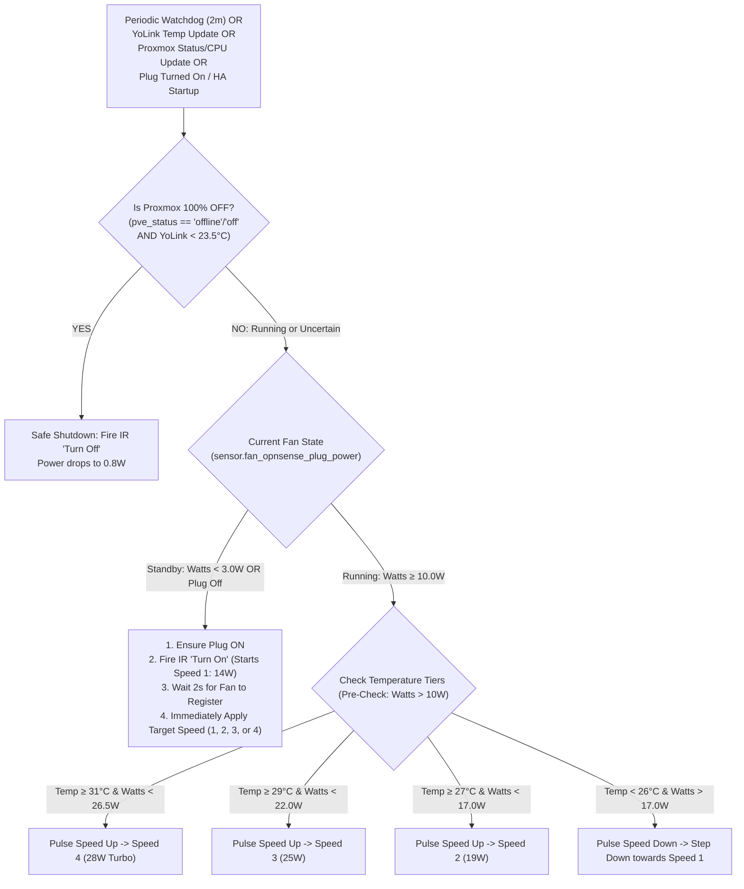

# Implementation Plan & Benchmark: 4-Speed Closed-Loop Homelab Cooling Automation

**Date:** 2026-10-31  
**Target Automation:** `automations/fan_thermal_cooling_watchdog.yaml` (`automation.closet_homelab_fan_thermal_watchdog`)  
**Status:** Implemented & Verified on Hardware  

---

## 1. Verified Hardware Power Benchmarks

Tested live using Third Reality Zigbee Smart Plug (`switch.fan_opnsense_plug`) and HOBEIAN Zigbee IR Blaster:

| Setting | Measured Power (Watts) | Profile | Action in Automation |
| :---: | :---: | :--- | :--- |
| **Standby / Off** | **`0.8 W`** ($< 3.0\text{ W}$) | Motor stopped | Cooldown state (`pve_status` confirmed off + temp < 23.5°C) |
| **Speed 1** | **`14.0 W – 14.5 W`** ($> 10\text{ W}$) | Silent / Gentle | Base cooling ($T \ge 25.0^\circ\text{C}$ or fail-safe trigger) |
| **Speed 2** | **`19.2 W – 19.5 W`** | Moderate | Increased load / ambient ($T \ge 27.0^\circ\text{C}$) |
| **Speed 3** | **`24.8 W`** | High Airflow | Warm closet ($T \ge 29.0^\circ\text{C}$) |
| **Speed 4** | **`28.2 W`** | **Max Turbo** | Emergency cooling ($T \ge 31.0^\circ\text{C}$ or CPU $\ge 75^\circ\text{C}$) |

---

## 2. Speed Stepping & Self-Healing Watchdog Architecture

---

## 3. Fail-Safe Mode (Uncertainty Principle)
* If `binary_sensor.pve_status` is `unavailable` or `unknown`: **Fan Forced ON**.
* If `sensor.temperature_sensor_temperature` is `unavailable` or `unknown`: **Fan Forced ON**.
* If `sensor.fan_opnsense_plug_power` is `unavailable` or `unknown`: **Fan Forced ON**.
* If YoLink battery drops below $10\%$: **Fan Forced ON**.
* Third Reality hardware setting `select.fan_opnsense_plug_power_on_behavior` is set to `on` (relay closes instantly on line power return).
* Periodic watchdog interval runs every 2 minutes (`minutes: "/2"`) ensuring automatic self-healing even if an IR command is ever missed.
