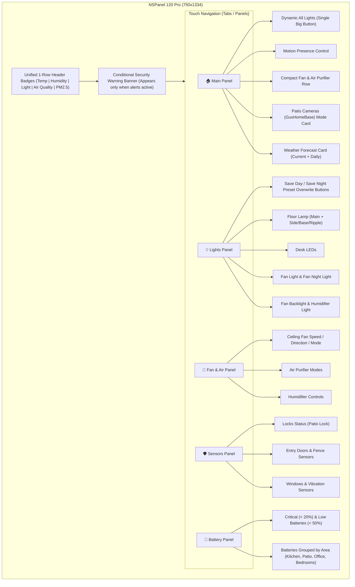

# Implementation Plan: Office NSPanel Dashboard Redesign & Multi-Panel Modular Architecture

**Date**: 2026-11-03  
**Status**: Proposed (Awaiting User Approval)  
**Target Device**: Sonoff NSPanel 120 Pro (4.7-inch 750x1334 portrait touch display)  
**Location**: Office (formerly Den)  
**Target Files**:
- `dashboards/nspanel-office.yaml` (renamed from `dashboards/nspanel-den.yaml`)
- `templates/security_warnings.yaml` [NEW]
- `scripts/office_lighting_presets.yaml` [NEW]
- `scripts/office_all_lights.yaml` [NEW/MODIFY]
- `doc/2026-11-03-office-nspanel-redesign.md` [NEW]

---

## 1. Goal Description

Redesign the Sonoff NSPanel 120 Pro wall display dashboard to solve visual clutter, eliminate unnecessary scrolling, transition naming from **Den** to **Office**, and establish a modular, multi-panel template that can be reused for the upcoming Bedroom NSPanel.

### Key Objectives:
1. **Renaming & Scope**: Rename dashboard from Den to Office (`dashboards/nspanel-office.yaml`, URL `/nspanel-office`).
2. **Multi-Panel (Tab) Architecture**: Split the dense single view into clean, touch-friendly panels:
   - **Main Panel** (`office`): Instant room summary, dynamic master light button, compact Fan/Air controls, Patio Cameras (`alarm_control_panel.gushomebase`), weather forecast, and active warnings.
   - **Lights Panel** (`lights`): Individual fixtures, dimmers, RGB/Kelvin controls, plus manual "Save Day Preset" / "Save Night Preset" snapshot buttons.
   - **Fan & Air Panel** (`climate`): Detailed ceiling fan speed/direction/preset sliders, air purifier modes, and humidifier setpoint.
   - **Sensors Panel** (`sensors`): Doors, fence, windows, locks, and room motion/presence.
   - **Battery Panel** (`battery`): All battery-powered devices grouped by area, sorted lowest-battery first.
3. **Header Clean-up (1-Row Fix)**: Remove Presence from the top badges across all panels (since presence is already prominently featured in the main body), consolidating the header into a clean, single-row layout (`Temp`, `Humidity`, `Light`, `Air`, `PM2.5`).
4. **Dynamic All Lights Button**: Replace the dual 2-button row with a single large, contextual button:
   - When any light is ON: displays "All Lights Off" with active count, tapping turns all off.
   - When all lights are OFF: displays "All Lights On", tapping turns all on.
5. **Auditory & Haptic Feedback**: Add tactile haptics (`haptic: selection`) on screen touch, and trigger distinct audible chime/beep feedback for turn-on vs. turn-off via the NSPanel Pro speaker (`button.zigbee2cube_1002a32fc7_speaker_start`).
6. **Patio Cameras Integration**: Display `alarm_control_panel.gushomebase` as "Patio Cameras" with one-touch mode changes (Disarmed, Home, Away).
7. **Reusable Warning Alert System**: Create a global template alert sensor model that automatically triggers dashboard warning banners when critical sensors remain open/unlocked past predefined safety thresholds (e.g., Patio lock unlocked > 30 min, Fence open > 10 min, Front Door open > 10 min).
8. **Manual Day/Night Preset Buttons**: Eliminate fragile automated state-tracking heuristics in favor of explicit user control: user adjusts lights to taste, then taps "Save Day Lights" or "Save Night Lights" to overwrite the preset scene.

---

## 2. User Review Required

> [!IMPORTANT]
> **Dashboard URL & Filename Rename**:
> We will rename `dashboards/nspanel-den.yaml` to `dashboards/nspanel-office.yaml` with URL `nspanel-office`. If you have your physical NSPanel Pro browser or Home Assistant companion app bookmarked directly to `/nspanel-den`, we can either set up an alias or keep `/nspanel-den` as a redirect while moving the primary to `/nspanel-office`.

> [!TIP]
> **NSPanel Audio Beep vs. Screen Haptics**:
> - **Screen Vibration**: We will add `haptic: medium` to the button tap actions. If the NSPanel Pro Android webview supports the HTML5 Vibration API, it vibrates immediately upon touch.
> - **Audio Beep / Chimes**: The NSPanel Pro exposed by Zigbee2Cube includes `text.zigbee2cube_1002a32fc7_audio_address` and `button.zigbee2cube_1002a32fc7_speaker_start`. We will implement a helper script `script.nspanel_audio_feedback(tone='on'|'off')` that can play distinct short chimes on the speaker.

---

## 3. Architecture & Panel Layouts



---

## 4. Proposed Changes

### Component 1: Warning & Alert Sensor Infrastructure
#### [NEW] `templates/security_warnings.yaml`
Reusable template binary sensors that track prolonged states:
```yaml
template:
  - binary_sensor:
      - name: Alert Patio Door Unlocked
        unique_id: alert_patio_door_unlocked
        state: "{{ is_state('lock.patio_door_lock', 'unlocked') }}"
        delay_on: "00:30:00"
        device_class: problem
        icon: mdi:lock-alert

      - name: Alert Patio Fence Open
        unique_id: alert_patio_fence_open
        state: "{{ is_state('binary_sensor.patio_fence_sensor', 'on') }}"
        delay_on: "00:10:00"
        device_class: problem
        icon: mdi:gate-alert

      - name: Alert Front Door Open
        unique_id: alert_front_door_open
        state: "{{ is_state('binary_sensor.door_sensor_door', 'on') }}"
        delay_on: "00:10:00"
        device_class: problem
        icon: mdi:door-open

      - name: Active Security Warnings
        unique_id: active_security_warnings
        state: >-
          {{ is_state('binary_sensor.alert_patio_door_unlocked', 'on')
             or is_state('binary_sensor.alert_patio_fence_open', 'on')
             or is_state('binary_sensor.alert_front_door_open', 'on') }}
        icon: mdi:alert-circle
```

---

### Component 2: Lighting Presets & Audio Feedback Scripts
#### [NEW] `scripts/office_lighting_presets.yaml`
Allows manual overwriting of Day and Night scenes:
```yaml
alias: Office Save Day Lights Preset
description: Overwrites the Day preset scene with current light attributes.
sequence:
  - action: scene.create
    data:
      scene_id: office_day_preset
      snapshot_entities:
        - light.office_floor_lamp
        - light.office_desk_leds
        - light.den_fan_light
        - light.humidifier_night_light
        - switch.office_floor_lamp_side_light
        - switch.office_floor_lamp_bottom_light
        - switch.office_floor_lamp_ripple_light
  - action: script.nspanel_audio_feedback
    data:
      tone: save

---
alias: Office Save Night Lights Preset
description: Overwrites the Night preset scene with current light attributes.
sequence:
  - action: scene.create
    data:
      scene_id: office_night_preset
      snapshot_entities:
        - light.den_night_light
        - light.humidifier_night_light
  - action: script.nspanel_audio_feedback
    data:
      tone: save
```

#### [NEW/MODIFY] `scripts/office_all_lights.yaml`
Master All Lights On/Off scripts updated with NSPanel Pro audio chimes and preset activation:
- `script.office_all_lights_on`: Plays high tone chime, restores `scene.office_day_preset` (or default day profile), triggers haptic vibration.
- `script.office_all_lights_off`: Plays low tone chime, turns off all fixtures, triggers haptic vibration.

---

### Component 3: Dashboard Layout (`dashboards/nspanel-office.yaml`)
#### [NEW] `dashboards/nspanel-office.yaml` (replacing `nspanel-den.yaml`)
Structure:
1. **Unified Header Badges** (All Views):
   - `sensor.office_presence_fp300_temperature` (Temp)
   - `sensor.office_presence_fp300_humidity` (Humidity)
   - `sensor.den_light_level` (Light)
   - `sensor.office_air_purifier_air_quality` (Air)
   - `sensor.den_pm2_5_level` (PM2.5)
   *(Presence badge removed, leaving exactly 5 badges that fit horizontally in 1 line on the 750px display!)*

2. **Conditional Warning Card** (Top of views):
   - Shows conditional card when `binary_sensor.active_security_warnings` is `on` with an amber/red warning tile indicating which door/lock has been open.

3. **View 1: Main Panel (`path: office`, title: "Office", icon: `mdi:home-outline`)**:
   - **Dynamic Big All Lights Button**:
     - Custom button card styled 80px high, spanning full width.
     - Automatically switches icon and text:
       - If any light is on: `All Lights Off` (icon glowing/amber, showing badge with count of active lights, tap executes `script.office_all_lights_off` with `haptic: selection`).
       - If all lights are off: `All Lights On` (icon grey/subtle, showing "0 on", tap executes `script.office_all_lights_on` with `haptic: selection`).
   - **Motion Presence Control**: Compact tile/button (60px high) toggling presence automation/override.
   - **Compact Fan & Air Purifier Row**:
     - 2-column grid:
       - Fan: tile with toggle + compact speed slider.
       - Air Purifier: tile with toggle + preset mode dropdown (`auto`, `silent`, `favorite`).
   - **Patio Cameras Card** (`alarm_control_panel.gushomebase`):
     - Friendly name "Patio Cameras", showing current status (Disarmed / Armed Home / Armed Away) with mode selector.
   - **Weather Card**:
     - `weather-forecast` card for `weather.forecast_home` displaying current condition, temperature, and 4-day forecast without taking excessive space.

4. **View 2: Lights Panel (`path: lights`, title: "Lights", icon: `mdi:lightbulb-multiple-outline`)**:
   - **Preset Management Bar**:
     - 2-column grid at top:
       - Button `💾 Save Day Lights`: snapshots current fixture states into Day profile.
       - Button `🌙 Save Night Lights`: snapshots current fixture states into Night profile.
   - **Light Fixtures (2-column grids)**:
     - Floor Lamp (Master tile + sub-lights stack).
     - Desk LEDs (tile with brightness slider).
     - Fan Light (brightness + Kelvin temp).
     - Fan Night Light (brightness + warm temp).
     - Fan Backlight & Fan Scene stack.
     - Humidifier Night Light.

5. **View 3: Fan & Air Panel (`path: climate`, title: "Climate", icon: `mdi:fan`)**:
   - Ceiling Fan: speed slider, direction toggle, natural breeze preset.
   - Air Purifier: speed / auto / silent mode, filter life indicator, child lock.
   - Humidifier: target humidity slider and mode.

6. **View 4: Sensors Panel (`path: sensors`, title: "Sensors", icon: `mdi:shield-check-outline`)**:
   - **Locks Section**: Patio Door Lock status and lock/unlock toggle.
   - **Perimeter & Doors**: Patio Fence Sensor, Kitchen Door Sensor, Window Sensor.
   - **Presence & Environment**: FP300 presence, motion sensors, vibration sensor.

7. **View 5: Battery Panel (`path: battery`, title: "Battery", icon: `mdi:battery-high`)**:
   - **Attention Needed / Low Battery Section**:
     - Automatically surfaces devices under 50% (e.g., Motion Sensor Right at 25%, Vibration Sensor at 50%).
   - **Area Grouped Batteries**:
     - Patio: Fence sensor (100%), Door lock (90%), Motion sensor right (25%).
     - Kitchen: Door sensor (75%), Botao Ikea (100%), IR remote (100%), UPS (100%).
     - Office: FP300 (100%), Soil moisture (100%), NSPanel battery (100%).
     - Bedrooms: Guest bedroom motion (66%), Main bedroom motion.

---

## 5. Verification Plan

### Automated & Syntactic Tests
- Run YAML syntax verification via sandboxed python yaml parser on all new/modified YAML files:
  `python3 -c "import yaml; yaml.safe_load(open('dashboards/nspanel-office.yaml')); yaml.safe_load(open('templates/security_warnings.yaml'))"`
- Validate Home Assistant entity IDs and dashboard schema with `ha_config_get_dashboard`.

### Manual & UI Verification
- Verify in HA frontend that the dashboard loads at `/nspanel-office`.
- Verify the header badges fit on a single row (no second-row wrapping) as seen on the physical NSPanel Pro.
- Verify the dynamic master light button toggles cleanly between "All Lights On" and "All Lights Off" without layout shift.
- Verify that pressing the master button produces tactile haptic feedback and triggers the speaker chime.
- Verify that "Patio Cameras" allows switching alarm states.
- Verify that saving day/night presets snapshots and restores lighting correctly without affecting Govee or Tuya hardware sync.
- Verify the battery panel displays low battery devices first and organizes by area.
- Verify that opening a door or fence sensor triggers the warning banner after the threshold period.

---

## 6. Versioning & Git Workflow

- Dedicated branch: `feature/office-nspanel-redesign`
- Version increment: `0.3.0` (MINOR: New panels, warning system, and preset architecture).
- Changelog update in `CHANGELOG.md` under `## 0.3.0`.
